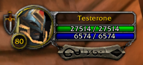
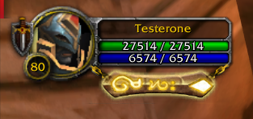
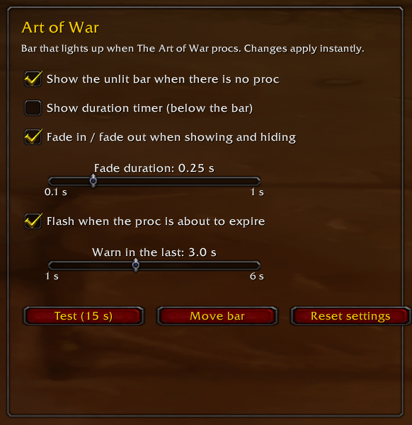

# Art of War

[English](README.md)

Una barra estilo Cataclysm para paladines Reprensión en World of Warcraft 3.3.5a (WotLK) que se enciende cuando salta **El Arte de la Guerra**.

Cuando el proc está activo, la barra brilla con sus runas doradas y sabés de un vistazo que tu próximo Destello de Luz o Exorcismo es instantáneo.

| Sin proc | Con El Arte de la Guerra |
|---|---|
|  |  |

## Funciones

- Barra estilo Poder Sagrado de Cataclysm en HD.
- Pegada al marco del jugador: sigue su posición y su escala. Funciona con el marco de Blizzard y con Nidhaus UnitFrames.
- Barra apagada opcional mientras no hay proc.
- Contador de duración opcional debajo de la barra.
- Fade in / fade out con duración ajustable.
- Parpadea cuando el proc está por perderse (ajustable).
- Funciona en cualquier idioma del cliente.
- Botón de prueba y barra movible.

## Instalación

1. Descargá este repositorio (**Code → Download ZIP**).
2. Copiá la carpeta `ArtOfWar` en `World of Warcraft/Interface/AddOns/`.
3. Verificá que **Art of War** esté activado en la lista de AddOns de la pantalla de personajes.

## Uso

Escribí `/aow` para abrir las opciones (también en **Esc → Interfaz → AddOns → Art of War**).

| Comando | Qué hace |
|---|---|
| `/aow` | Abre las opciones |
| `/aow move` | Desbloquea / fija la barra para arrastrarla |
| `/aow base` | Muestra / oculta la barra apagada |
| `/aow test` | Enciende la barra 15 segundos |
| `/aow reset` | Restaura los valores y la posición de fábrica |

## Requisitos

- WotLK 3.3.5a (Interface `30300`)

## Créditos

Hecho por **Nidhaus**.
