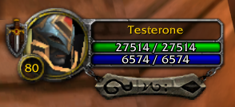
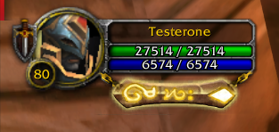
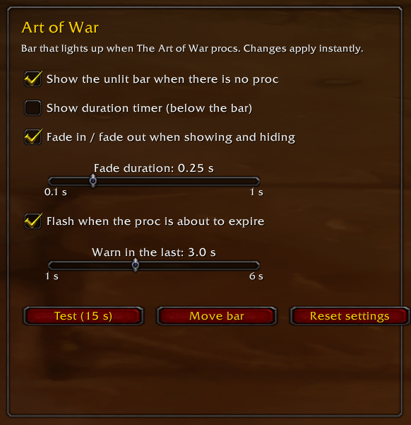

# Art of War

[Español](README.es.md)

A Cataclysm-style bar for Retribution Paladins in World of Warcraft 3.3.5a (WotLK) that lights up when **The Art of War** procs.

When the proc is up, the bar glows with its golden runes, so you know at a glance that your next Flash of Light or Exorcism is instant.

| No proc | The Art of War is up |
|---|---|
|  |  |

## Features

- Cataclysm Holy Power–style bar in HD.
- Attached to your player frame: it follows its position and scale. Works with the default Blizzard frame and with Nidhaus UnitFrames.
- Optional unlit bar while there is no proc.
- Optional duration timer below the bar.
- Fade in / fade out with adjustable duration.
- Flashes when the proc is about to expire (adjustable).
- Works in any client language.
- Test button and movable bar.

## Installation

1. Download this repository (**Code → Download ZIP**).
2. Copy the `ArtOfWar` folder into `World of Warcraft/Interface/AddOns/`.
3. Make sure **Art of War** is enabled in the AddOns list on the character select screen.

## Usage

Type `/aow` to open the options (also under **Esc → Interface → AddOns → Art of War**).

| Command | What it does |
|---|---|
| `/aow` | Open the options |
| `/aow move` | Unlock / lock the bar to drag it |
| `/aow base` | Show / hide the unlit bar |
| `/aow test` | Light up the bar for 15 seconds |
| `/aow reset` | Restore the default settings and position |

## Requirements

- WotLK 3.3.5a (Interface `30300`)

## Credits

Made by **Nidhaus**.
